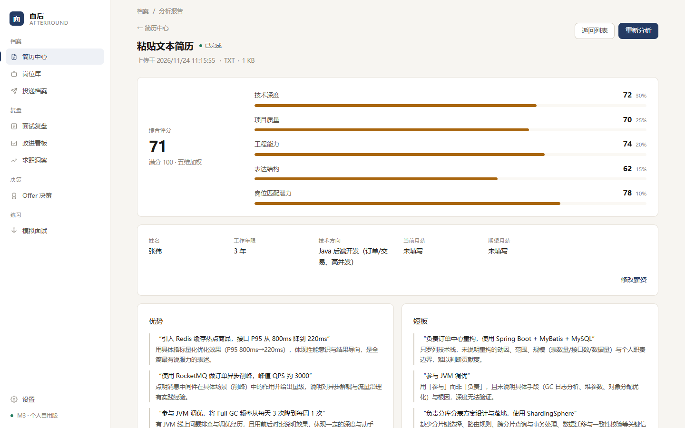
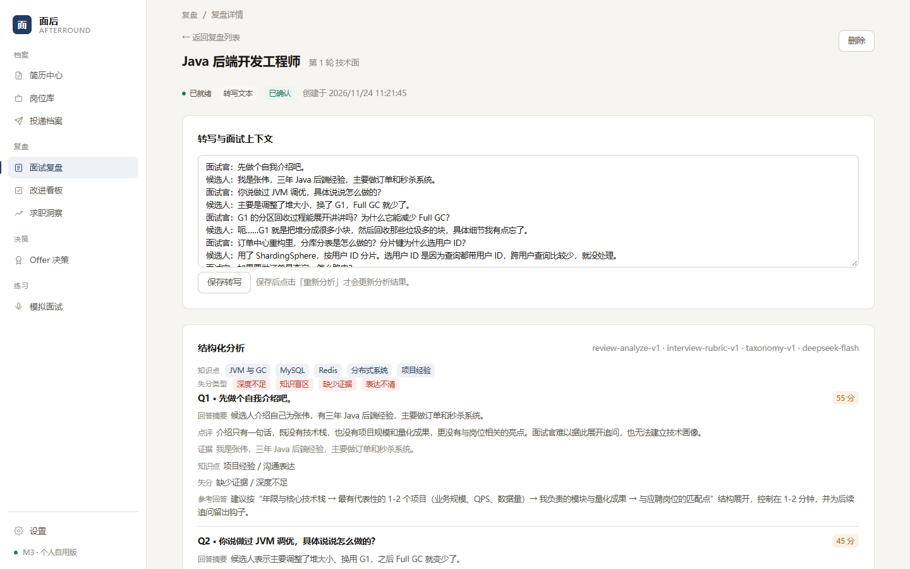
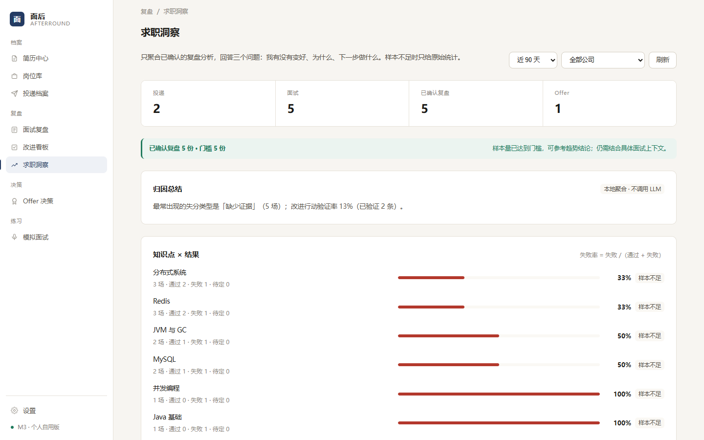
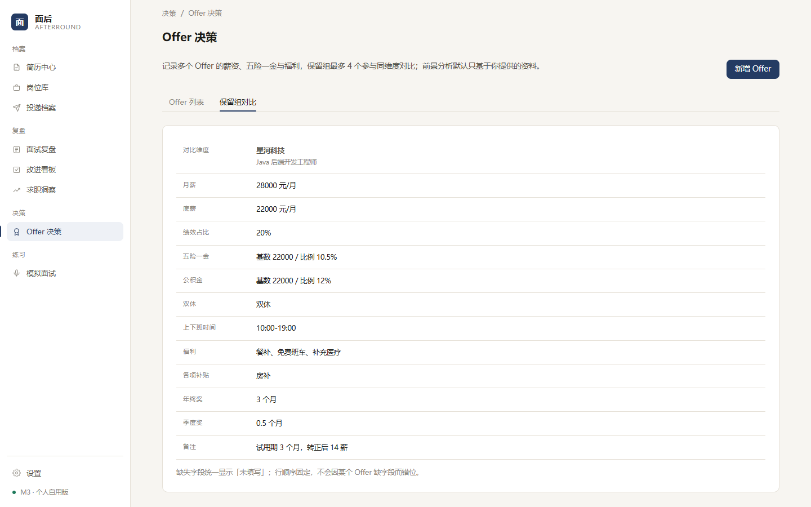

# 面后（AfterRound）

> 把每一场真实面试，变成下一场的准备。

[](https://github.com/Stitch626-China/afterround/actions/workflows/ci.yml)


个人求职档案与决策系统：**简历分析 → 岗位匹配 → 真实面试复盘 → 跨场归因 → 改进闭环 → Offer 决策**。

当前为**个人自用版**：免登录、单用户、本地部署；数据表预留 `user_id`，不堵死后续产品化路径。
项目**没有登录鉴权**，只能在本机或内网使用，请勿把端口直接暴露到公网。

## 截图

| 简历分析 | 真实面试复盘 |
|:---:|:---:|
|  |  |
| 五维评分、优势短板、原句优化与岗位方向 | 转写、结构化分析、失分标签与改进行动 |

| 求职洞察 | Offer 决策 |
|:---:|:---:|
|  |  |
| 跨场归因：知识点失败率、失分频次、轮次通过率与趋势 | 固定 12 维同维度对比，保留 / 淘汰可反悔 |

## 为什么做

求职信息是散的：简历在文件夹里，JD 在招聘 App 里，面试反馈在聊天记录和脑子里。于是三个问题反复出现：

- **同类问题反复丢分**：说不清是 JVM、系统设计还是表达结构在拖后腿；
- **改动无法归因**：换了一版简历、换了一种答法，不知道是哪次改动带来了下一轮面试；
- **复盘停留在「下次注意」**：没有记录、没有验证，也没有跨场比较。

市面上的工具大多集中在「面试前」——模拟面试、题库、实时提示。真正缺的是「面试后」：把每场真实面试沉淀成结构化档案，跨场比较、归因，并验证改进是否生效。

**面后补的就是这一段**。设计原则：

- **不增加用户工作量**：复盘录入目标 ≤5 分钟，必填不超过 3 项；
- **数据可修正**：AI 产出的问题、标签、总结、行动都可以改，用户值优先；
- **一致性优先**：固定模板 + 固定权重 + 低温度，分数由本地计算，模型不负责改维度。

## 核心能力

| 模块 | 做什么 |
|---|---|
| 简历中心 | 上传即分析：五维评分、优势短板、原句优化、岗位方向推荐、薪资可改 |
| 岗位库 | JD 文本 / 文件 / 截图导入，结构化解析，简历-JD 匹配评分与差距建议，行情统计 |
| 投递档案 | 一次投递 = 岗位 + 简历版本 + 状态；时间线串起面试轮次、复盘与改进动作 |
| 真实面试复盘 | 录音 / 转写 / 笔记三种输入，≤5 分钟录入；岗位还没入库时可填公司 + 岗位名快速新建（标「手动录入」，不计入行情）；可选补充公司介绍 / JD / 简历让分析更贴合；转写失败可改用文本；可标记本轮通过 / 淘汰 / 待定，自动产出问题、知识点、失分标签与改进行动 |
| 求职洞察 | 跨场聚合：知识点失败率、失分频次、轮次通过率、公司画像、漏斗与趋势（N<5 显示样本不足） |
| 改进看板 | 行动状态流转与验证证据，形成可追踪的改进闭环 |
| Offer 决策 | 多 Offer 固定 12 行同维度对比，保留 / 淘汰可反悔，前景分析 |
| 模拟面试（可选） | 结构化出题、追问、交卷评估；作为真实面试前的练习，不是产品核心 |

## 技术栈

| 层 | 选型 | 说明 |
|---|---|---|
| 后端 | Java 21 + Spring Boot 3.5 | REST + SSE 流式输出 |
| 持久层 | MyBatis-Plus + Flyway | JSONB 字段处理；SQL 版本化迁移 |
| 数据库 | PostgreSQL 16 | JSONB + CHECK 约束（状态机） |
| 模型网关 | 手写 WebClient（OpenAI 兼容） | 不用 Spring AI / LangChain4j，便于会话级绑定、调用追溯与结构化修复 |
| Provider 配置 | 数据库驱动，运行时可改 | 页面 CRUD 即时生效；API Key AES-GCM 加密落库并掩码 |
| 前端 | Vue3 + TypeScript + Vite | 无 UI 库；统一 design tokens |
| 接口契约 | `contracts/openapi.yaml` | 唯一接口源，前端类型由契约生成，后端有契约一致性测试 |
| 测试 | JUnit5 + Testcontainers + Vitest + Playwright | LLM 全 Mock；真实 PostgreSQL 只用于集成测试 |

## 架构

```
Vue3 SPA（简历 / 岗位 / 投递 / 复盘 / 洞察 / Offer）
        │  REST + SSE
Spring Boot 3.5（Java 21）
  ├── modules/     resume · job · application · review · insights · interview · offer · llm · chat
  ├── common/llm   OpenAI 兼容客户端、JSON 修复、结构化重试、调用埋点
  └── infrastructure  Provider 客户端缓存 · AES-GCM · 本地文件存储
        │
PostgreSQL 16（JSONB + Flyway）  +  本地磁盘文件
```

关键取舍：

- **契约先行**：先改 `contracts/openapi.yaml`，再实现后端并跑契约一致性测试，前端类型由契约生成；
- **结构化输出统一收口**：JSON 模式 + 低温度 + 本地修复 + 带错误反馈重试（≤3）+ 本地兜底校验；
- **跨场洞察不调用 LLM**：PostgreSQL JSONB 原生聚合，快且稳定；只有单场复盘分析调用模型。

## 快速开始

### 前置要求

- JDK **21**（必须）、Maven 3.9+
- Node.js 20 LTS+、npm 10+
- Docker Engine 25+ 与 Docker Compose v2

### 1. 配置

```bash
cp .env.example .env
```

至少填写两项：

| 变量 | 说明 |
|---|---|
| `APP_SECRET_KEY` | Provider API Key 的 AES-GCM 主密钥，缺失时后端启动失败 |
| `DB_PASSWORD` | 数据库密码，与 Compose 保持一致 |

生成主密钥（PowerShell）：

```powershell
$bytes = New-Object byte[] 32
[Security.Cryptography.RandomNumberGenerator]::Create().GetBytes($bytes)
[Convert]::ToBase64String($bytes)
```

### 2. 启动数据库

```bash
docker compose up -d postgres
```

### 3. 启动后端

```bash
# macOS / Linux
set -a && source .env && set +a
cd backend && mvn spring-boot:run
```

```powershell
# Windows PowerShell
Get-Content .env | Where-Object { $_ -match '^\s*[A-Za-z_][A-Za-z0-9_]*=' } | ForEach-Object {
  $kv = $_ -split '=', 2
  [Environment]::SetEnvironmentVariable($kv[0].Trim(), $kv[1].Trim(), 'Process')
}
Set-Location backend
mvn spring-boot:run
```

健康检查：`http://localhost:8080/actuator/health`

### 4. 启动前端

```bash
cd frontend
npm ci
npm run dev
```

打开 `http://localhost:5173`，`/api` 已代理到 `8080`。

### 5. 配置模型并验收

1. 左下角「设置 → 模型服务」新增服务商（`baseUrl` 需包含 `/v1`），设为全局默认并做连通测试；
2. 简历中心上传 PDF / DOCX / DOC / TXT（≤5MB）或粘贴文本，等待分析完成；
3. 岗位库粘贴 JD → 等待解析 → 选简历发起匹配；
4. 面试复盘录入文本 → 等待分析 → 确认生成改进行动；
5. 打开求职洞察查看跨场聚合。

### 6. 可选：导入演示数据

想直接看到完整效果（简历报告、JD 匹配、5 场复盘、跨场洞察、Offer 对比），在后端运行且已配置全局默认模型后执行：

```bash
node scripts/seed-demo.mjs
```

脚本走真实 API，按公司名、岗位标题、简历姓名、投递与轮次复用已有数据，可重复执行；首次运行需要调用模型生成分析结果，耗时取决于上游速度。后端不在 8080 时传地址：`node scripts/seed-demo.mjs http://localhost:8081`。

更完整的配置项、部署方式、多设备使用与接口清单见 **[开发手册](docs/开发手册.md)**。

## 测试与 CI

```bash
# 后端：单元 + 契约 + Testcontainers 集成 + JaCoCo 门禁
cd backend && mvn test

# 前端：构建（含契约类型生成与类型检查）
cd frontend && npm run build

# 前端：单测与 E2E（E2E 全 mock，无需后端）
cd frontend && npm test
cd frontend && npm run test:e2e

# 契约校验（必须 0 error / 0 warning）
npx @redocly/cli lint contracts/openapi.yaml
```

CI 在 push 到 `main` 或创建 / 更新 PR 时自动运行；也可在 Actions 页面点「Run workflow」，或执行 `gh workflow run ci.yml` 手动触发。

| 指标 | 当前 |
|---|---|
| 后端测试 | 180 tests，JaCoCo 行覆盖 ≥85% 门禁 |
| 前端测试 | Vitest 26 + Playwright 16 E2E |
| 契约 | 88 端点，lint 0 error / 0 warning |
| CI | GitHub Actions 三 job：契约 / 后端 / 前端，全绿 |

## 目录结构

```
afterround/
├── backend/            Spring Boot 3.5 + Java 21
├── frontend/           Vue3 + TypeScript + Vite
├── contracts/          OpenAPI 唯一接口源
├── docs/               需求文档、开发手册、演示脚本、项目全记录、进度与会话
├── .github/workflows/  CI
├── docker-compose.yml  PostgreSQL + 后端
└── README.md
```

## 文档导航

| 文档 | 说明 |
|---|---|
| [开发手册](docs/开发手册.md) | 完整配置、部署、多设备、接口清单、前端实现、测试与协作流程 |
| [LLM 评测集语料规范](docs/LLM评测集语料规范.md) | 语料分层、目录结构、meta/expect 规范、脱敏与基线规则 |
| [需求文档](docs/superpowers/specs/面后（AfterRound）需求文档.md) | 唯一需求源：业务规则、验收标准、数据模型、里程碑 |
| [功能实现对照表](docs/功能实现对照表.md) | 每条需求是否完成、代码位置、前端操作路径与剩余缺口 |
| [接口契约](contracts/openapi.yaml) | 唯一接口源（OpenAPI 3.1），可直接预览或生成客户端 |
| [5 分钟演示脚本](docs/5分钟演示脚本.md) | 演示前准备、时间轴、点击路径、话术、追问与兜底 |
| [项目全记录与 AI 协作方法论](docs/项目全记录与AI协作方法论.md) | 时间线、设计决策、实现地图、协作实录与问题案例 |
| [CI/CD 方案](docs/ci-cd-plan.md) | CI 三 job 的落地过程与 Linux 环境问题复盘 |
| [进度与会话](docs/agent-memory/PROGRESS.md) | 当前进度、关键决策与逐次会话记录 |

## 授权与使用

本仓库目前**未附带开源许可证**（没有 `LICENSE` 文件），默认保留所有权利：

- 欢迎阅读、学习与交流，也欢迎提 Issue 讨论设计；
- 未经作者书面许可，不得复制、修改、分发代码或用于商业用途；
- 如需在其它项目引用代码，请先联系作者确认授权方式。

第三方依赖遵循各自许可证。产品名「面后 / AfterRound」仅用于本项目展示，未做商标注册；公开商用前请自行完成商标与合规检查。
